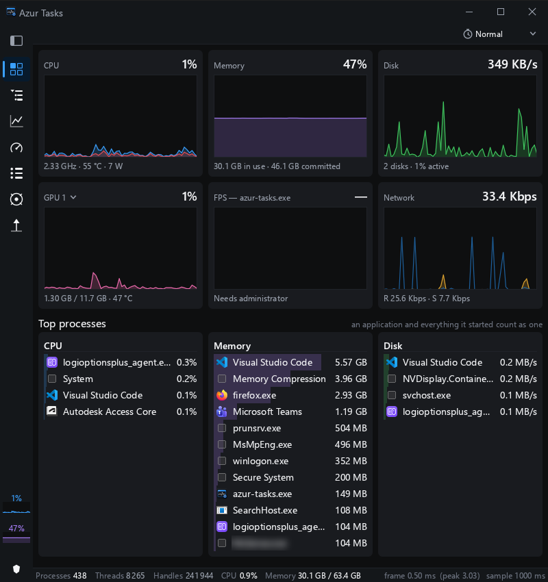
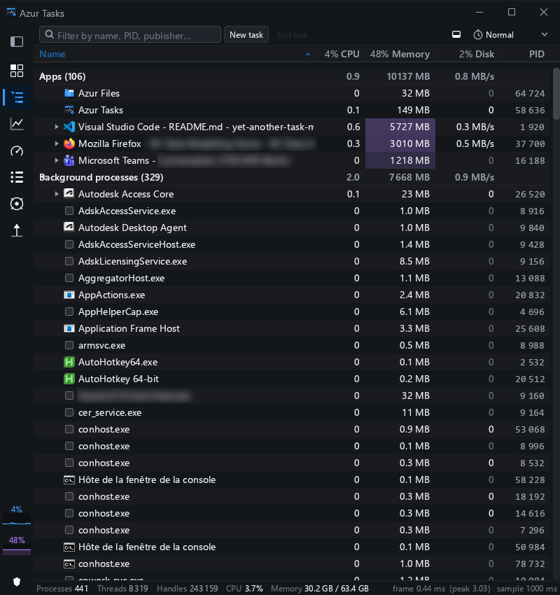
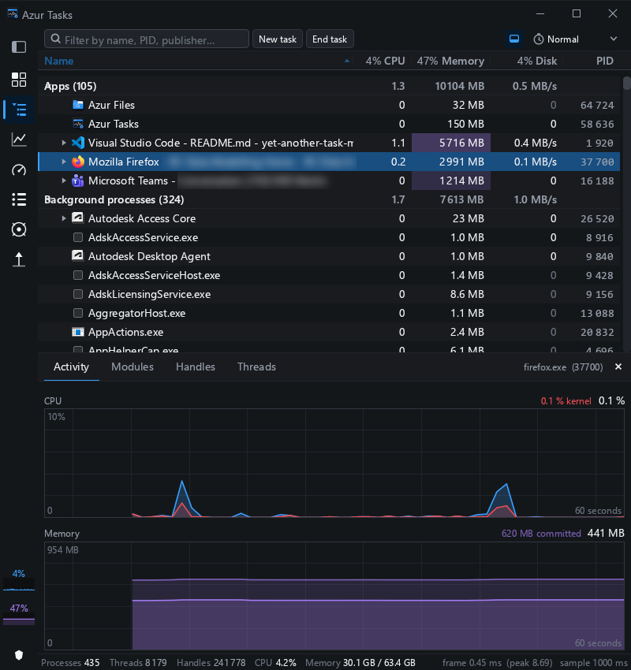
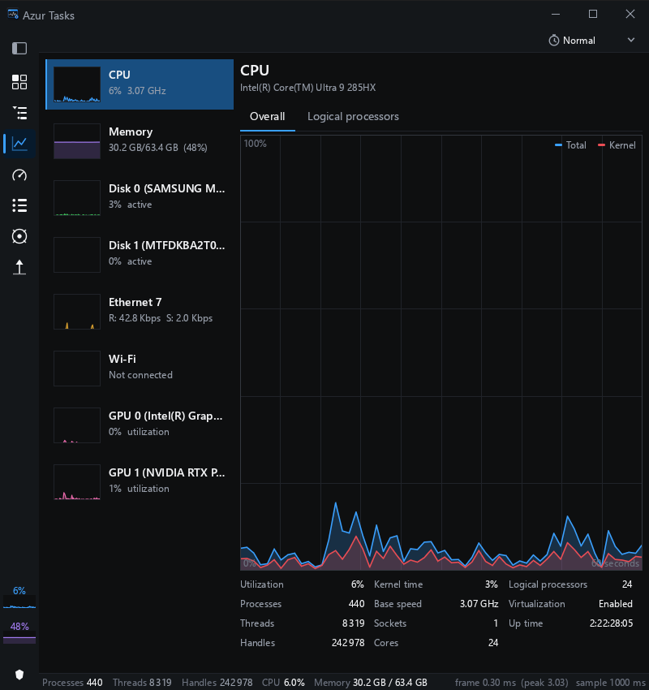
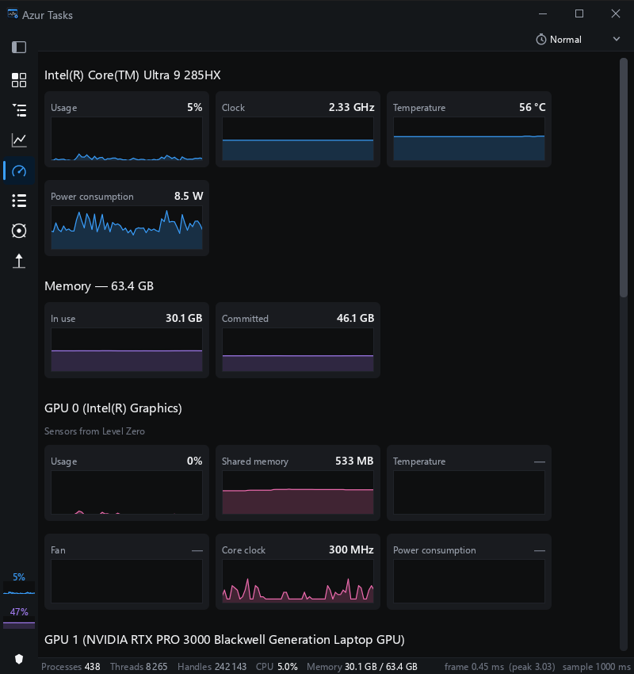
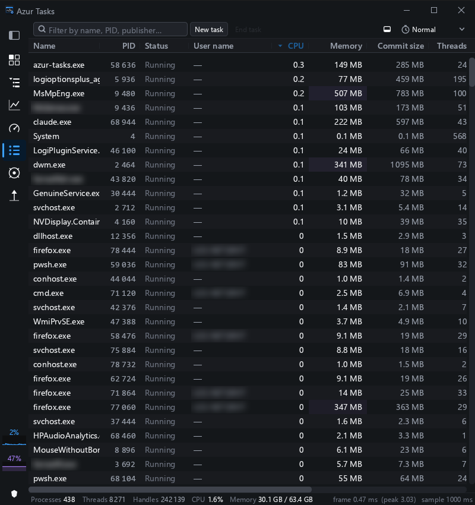
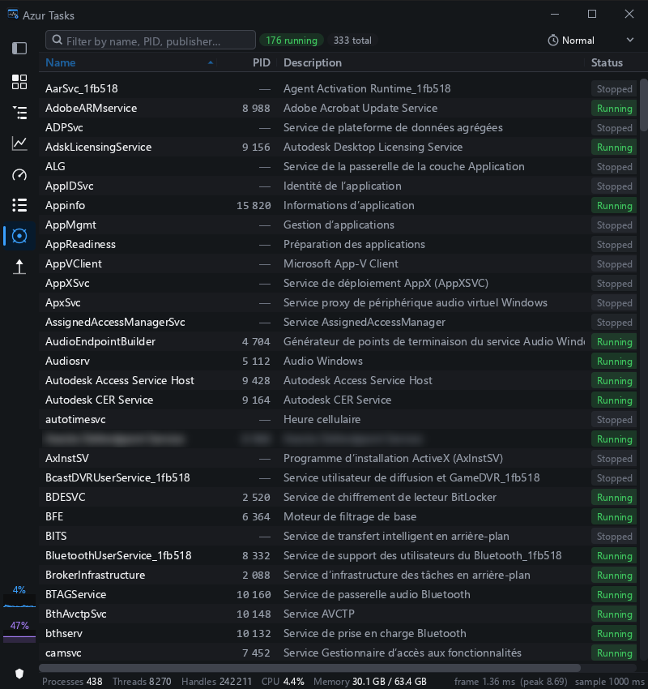
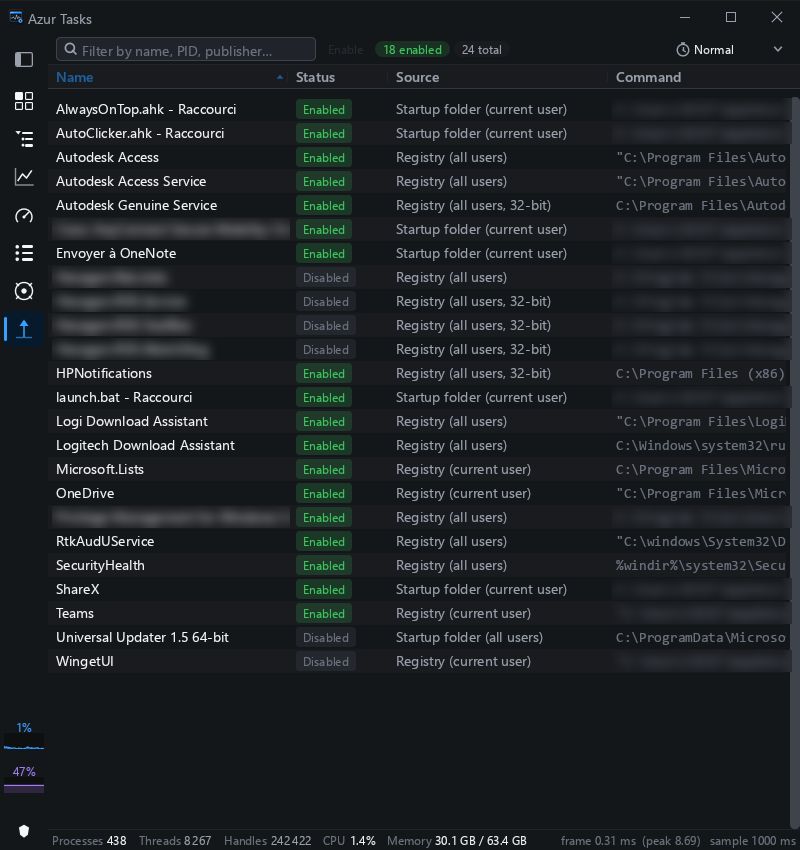

# Introduction

Azur Tasks is an alternative to the Windows Task Manager.

It shows everything the built-in one does — processes, performance graphs, services, startup
apps — and it costs almost nothing to leave open. While idle it sleeps: it only redraws when
there is a new reading or you touch it. It also shows what Task Manager hides behind other
tools: temperatures, clocks and power draw, the frame rate of the game in front of you, and the
DLLs, handles and threads inside any process.



# Features

- **light** — at rest it uses a fraction of the CPU Task Manager does, and the status bar
  shows the frame time as it goes
- **summary** — the whole machine on one page, with the processes using the most CPU, memory
  and disk
- **process tree** — apps with their helper processes folded underneath, so a browser counts
  as one row
- **inspector** — a process's CPU and memory history, its loaded modules, open handles and
  threads
- **sensors** — CPU and GPU temperature, clock, fan and power, as live traces
- **frame pacing** — FPS, 1 % lows and stutter for the foreground app (run as administrator)
- **services and startup apps** — see what runs, and switch startup entries on or off

Measured beside the real Task Manager on the same machine, both idle (24 cores, 64 GB RAM,
~550 processes):

| | Azur Tasks | Windows Task Manager |
|---|---|---|
| CPU at rest | **3.0 %** of one core | 20.6 % of one core |
| Working set | **206 MB** | 238 MB |
| Threads | **16** | 24 |

One 10 MB executable, with nothing to install beside it.

## Summary

The page the window opens on. Along the top, one card per resource — CPU, memory, disks,
network and each graphics card — with the last minute of history and the key figures: clock,
temperature and power for the CPU, temperature for a GPU.

Below, three rankings: the processes using the most CPU, memory and disk. An application and
everything it started count as one, so you see "Firefox, 2.4 GB" rather than forty helper
processes at 60 MB each.

Everything is a way in. Click a card to open that resource on the Performance page, click a
process to jump to it on the Processes page, right-click it for the usual actions.

## Processes

Every running process, in three sections: **Apps**, **Background processes** and **Suspended
processes**. An app's helper processes nest under it, and a folded row shows the total for
everything beneath it.



- Busy cells are tinted in their column's colour — only the few rows actually doing something
  stand out
- Window titles are shown app-first: `Visual Studio Code - main.rs`, not
  `main.rs - Visual Studio Code`
- Sort by name and the sections stay; sort by anything else and the list goes flat, so the
  busiest process is at the top whatever kind it is
- Hold **Ctrl** to freeze the order, so a row that keeps moving can be clicked
- Hover a row to see every column of it, uncropped
- Right-click for end task, end tree, open file location, properties, copy and priority

**New task** opens Windows' own Run dialog, right under the button.

### Inspector

Select a process and open the panel under the list to look inside it:

- **Activity** — its CPU (with kernel time) and memory over the last minute
- **Modules** — every DLL it has loaded, with base address, size and path
- **Handles** — the files, registry keys and other objects it holds open
- **Threads** — each thread and its state



## Performance

A live graph per resource: CPU (overall, or one graph per logical processor), memory, each
physical disk, each network adapter and each GPU. Pick one on the left for its full graph and
statistics — base speed, cores, uptime, handles, and so on.



## Sensors

What the machine reports about itself, as a one-minute trace per reading:

- **CPU** — usage, clock, package temperature and package power
- **GPU** — usage, video memory, temperature, hotspot, fan, core clock and power, read through
  the vendor's own library (NVIDIA, Intel and AMD)
- **Foreground application** — FPS, frame time, 99th-percentile FPS and micro-stutter
- **Memory** — in use and committed
- **Thermal zones** — every one your firmware publishes

None of it needs administrator rights, except frame pacing, which Windows only allows an
elevated process to read. A reading your hardware does not have shows "—" rather than a
misleading zero.



The page is yours to arrange: drag a card or a whole section to move it, and right-click to
choose what is shown. Your layout survives driver updates and a second graphics card.

## Details

One flat row per process, with 33 columns to choose from — memory in all its forms, handles,
threads, priority, I/O, CPU time, user, publisher, image path, command line. Right-click the
header to pick which ones you see.



## Services

Every Windows service, with its state, the process hosting it and its group. Right-click to
jump to the hosting process or open the folder its program lives in.



## Startup apps

What runs when you sign in: the `Run` registry keys and both Startup folders, with where each
entry comes from. Enable and disable use the same switch Windows' own settings do, so nothing
is deleted, and the change applies at your next sign-in. Entries for all users need
administrator rights.



# Keyboard and mouse

| | |
|---|---|
| **Ctrl** (held) | freeze the row order |
| ↑ ↓ | move the selection |
| → / ← | expand / collapse, or step into / out of a tree |
| Home / End | first / last row |
| Ctrl+F, F3 | filter |
| Esc | clear the filter, then the selection |
| F5 | take a reading now, even while paused |
| Del | end the selected process (it asks first) |
| Right-click a header | choose the columns |
| Drag a header edge | resize a column; click to sort |
| Sidebar icon | collapse the sidebar to icons |

The window goes down to 500 × 400: the sidebar folds to icons and the toolbar and status bar
give up space gracefully.

# Install

Azur Tasks is built from source. You need Rust, the MSVC toolchain and a Windows SDK, and the
[`azur-egui-theme`](../azur-egui-theme) repository checked out next to this one.

```powershell
cargo build --release
.\target\release\azur-tasks.exe
```

`cargo deploy` builds it and copies it to `D:\Programs`, or to `$AZUR_DEPLOY_DIR`, or to a
folder you name. It can replace a copy that is running.

No administrator rights are needed. Running as administrator adds frame pacing, and fills in
the rows of protected processes that otherwise show "—". Your window layout and columns are
kept in `%APPDATA%\Azur Tasks\settings.ini`, which is safe to delete.

# Limitations

- **No per-process network usage** — Windows only gives that to an elevated trace session.
  Per-adapter throughput on the Performance page is accurate.
- **No App history tab and no startup "impact"** — that data is not readable by an ordinary
  program.
- **Services are read-only** — starting and stopping them needs elevation.
- **GPU figures depend on the driver** — some drivers and most virtual machines publish none,
  and an integrated GPU has no temperature or fan of its own.
